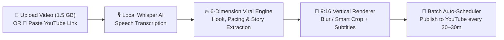

<div align="center">

# ⚡ ShortCut AI

### Free, Open-Source AI YouTube Shorts Generator, Vertical Editor & Auto-Scheduler

[](https://www.python.org/)
[](https://fastapi.tiangolo.com/)
[](https://react.dev/)
[](https://github.com/SYSTRAN/faster-whisper)
[](https://developers.google.com/youtube/v3)
[](LICENSE)

**Turn any long video or YouTube URL into dozens of viral, subtitled 9:16 YouTube Shorts and auto-schedule them to your channel — 100% locally on your PC with zero monthly subscriptions.**

[⚡ Quick Start](#-quick-start-windows) • [📺 Connect YouTube](#-how-to-connect-your-youtube-channel) • [📖 Full Setup Guide](SETUP_GUIDE.md) • [✨ Features](#-why-choose-shortcut-ai)

</div>

---

## 🌟 Why Choose ShortCut AI?

Most AI clipping tools charge $20–$50/month, watermark your exports, cap your video length, or force you to upload huge files to slow cloud servers. **ShortCut AI runs 100% locally on your own computer:**

| Feature | Paid Cloud Clipping Tools | ⚡ ShortCut AI (Open Source) |
| :--- | :---: | :---: |
| **Monthly Cost / Subscriptions** | $19 – $99 / month | **$0 (100% Free Forever)** |
| **Max Video Upload Size** | Limited by plan tier | **Up to 1.5 GB per video** |
| **AI Transcription & Scoring** | Paid cloud minutes | **Unlimited Local Whisper AI** |
| **Watermarks** | On free/starter plans | **Zero Watermarks** |
| **YouTube Link Importer** | Often restricted | **Built-in (360p to 1080p)** |
| **9:16 Vertical Framing** | Fixed presets | **Blur Background, Auto & Smart Crop** |
| **Direct YouTube Batch Scheduler** | Extra paid add-on | **Built-in 20–30m Auto Stagger** |
| **Privacy** | Videos stored on 3rd-party servers | **100% Private & Local** |

---

## 🧠 How It Works



---

## ✨ Key Features

- **📁 Massive Local File Uploads (Up to 1.5 GB):** Streamlined multi-part uploads with a live byte-level progress bar, upload speed, and 4-stage pipeline status tracker.
- **🔗 Direct YouTube Link Downloader:** Paste any YouTube URL, preview thumbnail and video metadata, pick your resolution (`360p`, `480p`, `720p`, or `1080p`), and automatically pull and analyze clips — powered by Node.js challenge-solving and optional `cookies.txt` fallback.
- **🎙️ Fast Local Speech-to-Text:** Powered by [Faster-Whisper](https://github.com/SYSTRAN/faster-whisper) (INT8 quantized) for fast CPU/GPU transcription with no OpenAI API keys required.
- **🔥 AI Viral Moment Detection (6-Dimension Scoring):** Finds self-contained, high-retention narrative arcs based on emotional hooks, curiosity gaps, pacing, sentiment shifts, and dialogue density.
- **📱 3 Custom 9:16 Vertical Layouts:**
  - **Blur Background:** Crisp landscape content centered over a smooth blurred background.
  - **Auto Intelligent:** Automatically adapts framing ratio.
  - **Smart Center Crop:** Full-screen 9:16 vertical center framing.
  - **Burned-in Captions:** Automatic high-contrast subtitles rendered via FFmpeg.
- **📅 1-Click Batch Interval Scheduling:** Select 5, 10, or 20+ generated Shorts and schedule them all at once to publish every **20 minutes**, **30 minutes**, or custom intervals directly to your YouTube channel, tracked by a live upload queue progress bar.
- **🔐 Built-in YouTube Channel Connect Wizard:** Anyone can clone this repo, upload or paste their own Google Cloud `client_secrets.json` inside the web app, authorize via OAuth 2.0, and see their live YouTube channel avatar, name, and handle directly on the dashboard.

---

## ⚡ Quick Start (Windows)

### Prerequisites
Make sure these 3 free tools are installed on your PC:
1. **[Python 3.10+](https://www.python.org/downloads/)** *(Important: Check **"Add Python to PATH"** during install)*
2. **[Node.js 18+ LTS](https://nodejs.org/)** *(Required for the React UI & YouTube bot solver)*
3. **[FFmpeg](https://www.gyan.dev/ffmpeg/builds/)** *(Or install in 1 command via PowerShell: `winget install Gyan.FFmpeg`)*

### 1. Clone the Repository
```bash
git clone https://github.com/priyadharshan376/ShortCut-AI.git
cd ShortCut-AI
```

### 2. Run 1-Click Setup
Double-click **`Setup.bat`** in the project folder.
It automatically creates the virtual environment, installs Python dependencies, and builds the web interface.

### 3. Connect Your YouTube Channel
1. Follow the 3-minute steps in **[SETUP_GUIDE.md](SETUP_GUIDE.md)** to get your free `client_secrets.json` from Google Cloud Console.
2. Double-click **`Connect_YouTube.bat`** *(or connect directly inside the web UI)*.

### 4. Launch ShortCut AI
Double-click **`Start_ShortCutAI.bat`**.
Your browser automatically opens to **`http://localhost:8000`**.

---

## 📺 How to Connect Your YouTube Channel

1. Go to [Google Cloud Console](https://console.cloud.google.com/) and create a free project.
2. Enable **YouTube Data API v3**.
3. Configure the **OAuth consent screen** (`External`), add scopes `youtube.upload` and `youtube.readonly`, and add your Gmail under **Test Users**.
4. Create an **OAuth Client ID** (`Desktop app`) and download the JSON as `client_secrets.json`.
5. In the **ShortCut AI Dashboard**, click **"Connect YouTube Channel"**, upload/paste your credentials, and click **Allow** in your browser.

> **💡 Pro Tip (Important for High Volume Uploads):** Make sure your YouTube channel has **Phone Verification (Intermediate features)** enabled inside YouTube Studio > Settings > Channel > Feature eligibility. Unverified channels are capped by YouTube at a few uploads per day (`uploadLimitExceeded`).

For full screenshot-ready instructions and troubleshooting, see **[SETUP_GUIDE.md](SETUP_GUIDE.md)**.

---

## 🏗️ Project Architecture

```text
ShortCut-AI/
├── backend/
│   ├── app.py                     # FastAPI REST API & SPA server
│   ├── config.py                  # Upload limit (1.5 GB), Whisper & app config
│   ├── cleanup_port.py            # Windows port manager
│   ├── database/db.py             # SQLite persistence for projects, clips & logs
│   ├── modules/
│   │   ├── clip_detection.py      # 6-dimension viral scoring engine
│   │   ├── metadata_generator.py  # SEO title, description & hashtag builder
│   │   ├── subtitle_generator.py  # SRT & FFmpeg burned-in captions
│   │   ├── transcription.py       # Faster-Whisper speech recognition
│   │   ├── video_cropper.py       # 9:16 framing (Blur / Auto / Crop)
│   │   ├── video_input.py         # Chunked 1.5 GB disk streaming
│   │   ├── youtube_download.py    # yt-dlp + Node.js challenge bypass
│   │   └── youtube_upload.py      # YouTube Data API v3 OAuth & channel profile
│   └── services/
│       └── processing_service.py  # Async multi-stage AI pipeline
├── frontend/                      # React + Vite web dashboard
├── auth_youtube.py                # CLI OAuth connection helper
├── client_secrets.json.example    # Template for OAuth credentials
├── Setup.bat                      # 1-click installer
├── Start_ShortCutAI.bat           # 1-click app launcher
├── Connect_YouTube.bat            # 1-click YouTube auth
├── Stop_ShortCutAI.bat            # 1-click server shutdown
└── SETUP_GUIDE.md                 # Complete setup documentation
```

---

## 🔒 Privacy & Security

- Your `client_secrets.json`, OAuth tokens (`youtube_token.json`), SQLite database, and local videos are automatically excluded by [`.gitignore`](.gitignore).
- No telemetry, no analytics tracking, and no cloud API keys required.

---

## 🤝 Contributing & Support

Contributions, bug reports, and feature ideas are welcome!
- If **ShortCut AI** saves you time or money, please give this repository a **⭐ Star** on GitHub so more creators can find it!
- Found a bug or have an idea? Open an [Issue](https://github.com/priyadharshan376/ShortCut-AI/issues).

---

<div align="center">
Made with ❤️ for Creators & Automation Builders • Released under the <a href="LICENSE">MIT License</a>
</div>
